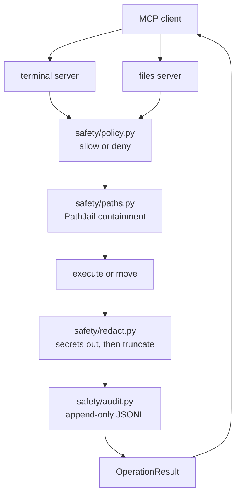

# safe-mcp-suite

Two [MCP](https://modelcontextprotocol.io) servers — a terminal and a file organizer — sharing one safety core that neither of them is allowed to bypass.

[](pyproject.toml)
[](LICENSE)
[](https://github.com/Asaad-Suliman/safe-mcp-suite/actions/workflows/ci.yml)
[](https://modelcontextprotocol.io)

---

## What this is

Search GitHub for an MCP server that runs shell commands and you will find the same file over and over: a tool decorated with `@mcp.tool()`, a call to `subprocess.run(command, shell=True)`, and the result handed straight back to the model. The filesystem ones are the same shape — `os.rename` in a loop, maybe a try/except around it.

They work. That is the problem. They work until the model produces something nobody anticipated, and by then the deletion has already happened, and there is no record of what ran or why it was allowed to.

This repo is those two servers rebuilt so that the safety **is** the design rather than a wrapper bolted on top. A single `safety/` package owns every decision that could hurt you — what is allowed, where the boundary is, what gets written down, what gets hidden. The two servers underneath it are wiring. Neither can reach past the core, because neither one implements a rule of its own.

The bet behind it: **deterministic policy is more trustworthy than model judgment.** A prompt can talk a model out of being careful. It cannot talk a path-containment check into returning `True`.

---

## Quickstart

You need Python 3.12+ and [uv](https://docs.astral.sh/uv/).

```sh
git clone https://github.com/Asaad-Suliman/safe-mcp-suite.git safe-mcp-suite
cd safe-mcp-suite
uv sync
./scripts/make_demo_sandbox.sh
```

That last script seeds `sandbox/terminal`, `sandbox/files`, and `state/` so both servers have somewhere legal to operate. Then start whichever one you want:

```sh
uv run safe-mcp terminal --config policy.example.toml
uv run safe-mcp files --config policy.example.toml
```

### About that `--config` flag

It is not optional, and there is no fallback. No ambient `./policy.toml` lookup, no `.env` loading, no default root that quietly points at your home directory. If neither `--config` nor `SAFE_MCP_POLICY_FILE` is set, the server prints why and exits.

This is deliberate and it is the single most opinionated thing about the setup. A sandbox that silently defaults to somewhere convenient is a sandbox that will one day default to somewhere expensive. Refusing to start is the cheapest possible failure.

Two policy files ship with the repo, and they are not interchangeable:

| File                  | What it is                                      | Will it start?     |
| --------------------- | ----------------------------------------------- | ------------------ |
| `policy.example.toml` | Working example, rooted at `./sandbox`          | Yes — run it now   |
| `policy.toml`         | Annotated template with the roots commented out | **No, on purpose** |

`policy.toml` refuses to start until you fill in `jail_root` and `workspace_root` yourself. That refusal is a feature, and there is a regression test holding it in place. Copy it, edit it, point it at real directories when you are ready.

The roots can also come from the environment if you prefer:

```sh
SAFE_MCP_JAIL_ROOT=/path/to/jail
SAFE_MCP_WORKSPACE_ROOT=/path/to/workspace
```

### Registering with an MCP client

```json
{
  "mcpServers": {
    "safe-mcp terminal": {
      "command": "uv",
      "args": ["run", "safe-mcp", "terminal"],
      "env": {
        "SAFE_MCP_POLICY_FILE": "/srv/safe-mcp/policy.example.toml",
        "SAFE_MCP_JAIL_ROOT": "/srv/safe-mcp/sandbox"
      }
    },
    "safe-mcp files": {
      "command": "uv",
      "args": ["run", "safe-mcp", "files"],
      "env": {
        "SAFE_MCP_POLICY_FILE": "/srv/safe-mcp/policy.example.toml",
        "SAFE_MCP_WORKSPACE_ROOT": "/srv/safe-mcp/inbox"
      }
    }
  }
}
```

---

## Demo

Everything below is real captured output. Nothing here is hand-written, trimmed, or prettified after the fact — these are the actual `OperationResult` envelopes returned by a live MCP client talking to both servers, run against the seeded sandbox from `./scripts/make_demo_sandbox.sh` with `policy.example.toml`.

Read the `code` field in each one. That taxonomy is the whole point: every outcome, success or refusal, comes back as the same shape.

### Terminal server

An allowed command:

```
>>> tool: run_command  args: {"command": "cat notes.txt"}
{
  "action": "run_command",
  "code": "OK",
  "detail": {
    "exit_code": 0,
    "stderr": "",
    "stdout": "demo file\n"
  },
  "duration_ms": 1,
  "ok": true,
  "reason": "'cat' is allowed"
}
```

A denied command:

```
>>> tool: run_command  args: {"command": "rm -rf /"}
{
  "action": "run_command",
  "code": "POLICY_DENIED",
  "detail": {},
  "duration_ms": 0,
  "ok": false,
  "reason": "'rm' is on the denylist"
}
```

Note what the denial is _not_: a traceback, a raised exception, or a string the model has to guess at. It is a typed code with a reason attached.

### Files server

This sequence runs against a seeded workspace containing ordinary files, an installer, a dotfile, and a symlink — one of each thing the policy treats differently.

`plan_organize` proposing moves and listing skips:

```
>>> tool: plan_organize  args: {}
{
  "action": "plan_organize",
  "code": "OK",
  "detail": {
    "created": "2026-08-07T16:49:00.048899+00:00",
    "move_count": 2,
    "moves": [
      {
        "category": "Images",
        "dest": "Images/photo.png",
        "size": 41,
        "src": "photo.png"
      },
      {
        "category": "Documents",
        "dest": "Documents/report.pdf",
        "size": 16,
        "src": "report.pdf"
      }
    ],
    "plan_id": "7dcf2cff-399d-4af5-bb9a-a4131e1d5288",
    "skip_count": 3,
    "skips": [
      {
        "code": "NEEDS_EXPLICIT_REQUEST",
        "name": ".bashrc",
        "reason": "dotfiles are configuration, not clutter to be filed",
        "rule": "organize"
      },
      {
        "code": "POLICY_DENIED",
        "name": "link.pdf",
        "reason": "'organize' is not permitted by any rule (deny by default)",
        "rule": null
      },
      {
        "code": "NEEDS_EXPLICIT_REQUEST",
        "name": "setup.exe",
        "reason": "installers, executables and application folders are left where the user put them",
        "rule": "organize"
      }
    ],
    "truncated": false
  },
  "duration_ms": 0,
  "ok": true,
  "reason": "proposed 2 move(s), skipped 3"
}
```

`apply_plan` executing that same plan:

```
>>> tool: apply_plan  args: {"plan_id": "7dcf2cff-399d-4af5-bb9a-a4131e1d5288"}
{
  "action": "apply_plan",
  "code": "OK",
  "detail": {
    "moved": 2,
    "moves": [
      {
        "dest": "Images/photo.png",
        "src": "photo.png"
      },
      {
        "dest": "Documents/report.pdf",
        "src": "report.pdf"
      }
    ],
    "plan_id": "7dcf2cff-399d-4af5-bb9a-a4131e1d5288",
    "planned": 2
  },
  "duration_ms": 2,
  "ok": true,
  "reason": "moved 2 file(s)"
}
```

Now the interesting pair. Same tool, two named targets, two different answers.

`move_file` refused by PROTECTION — the same symlink `plan_organize` skipped above, named explicitly:

```
>>> tool: move_file  args: {"src": "link.pdf", "dest": "Documents/link.pdf"}
{
  "action": "move_file",
  "code": "POLICY_DENIED",
  "detail": {},
  "duration_ms": 0,
  "ok": false,
  "reason": "'organize' is not permitted by any rule (deny by default)"
}
```

`move_file` succeeding on the installer `plan_organize` deferred with `NEEDS_EXPLICIT_REQUEST`, now named explicitly:

```
>>> tool: move_file  args: {"src": "setup.exe", "dest": "Documents/setup.exe"}
{
  "action": "move_file",
  "code": "OK",
  "detail": {
    "dest": "Documents/setup.exe",
    "moved": 1,
    "src": "setup.exe"
  },
  "duration_ms": 0,
  "ok": true,
  "reason": "moved setup.exe"
}
```

The planner refused both. Asked directly, the mover refused one and did the other. That difference is not an inconsistency — it is the two-layer model, and it gets its own section below.

---

## System design

### The servers are wiring, not policy

Neither server file contains a safety rule. Every one of them lives in `safety/`, and both servers reach the same functions to get the same answers.



This is not tidiness for its own sake. It means a security fix lands in exactly one place, and it means a reviewer auditing this repo reads `safety/` and is done. There is no second implementation hiding in a server module, drifting quietly out of sync with the first.

### How a request actually flows

1. **Parse.** The command string is split into an argv list. Shell metacharacters are rejected here, before anything is interpreted — including inside quotes. That last part is deliberately conservative and it is a documented ceiling, not an oversight.
2. **Evaluate.** The policy engine answers allow or deny. Deny always wins. Anything not explicitly permitted is refused, so an empty policy is a useless server rather than an open one.
3. **Contain.** Every path is resolved and checked against the jail root. Symlinks are inspected as links and never followed through.
4. **Act.** `subprocess.run` with `shell=False`, a scrubbed environment of exactly `PATH`, `HOME`, `LANG`, a timeout, and an output cap. Or, on the files side, a single guarded move recorded in a journal.
5. **Redact, then truncate.** In that order, always.
6. **Record.** Append to the audit log. If that write fails, the operation fails with it.

### Six decisions worth stealing

**Errors are data, not exceptions.** Every outcome is an `OperationResult` with a typed `ResultCode`. No traceback ever reaches the client. A model receiving a stack trace will try to work around it; a model receiving `POLICY_DENIED` has been told something useful and unambiguous.

**Deny wins, always.** Allow rules and deny rules are not weighted or ordered into a tiebreak. If a deny matches, the answer is no. Argument rules match tokens order-independently, so reshuffling flags is not a bypass.

**Nothing starts without an explicit root.** Covered in the Quickstart, but it belongs in the design list too, because "sensible default" is how most sandboxes acquire their first escape.

**The audit log is allowed to stop you.** Fail-closed by default: if the log cannot be written, the operation does not happen. You can flip it to fail-open with `SAFE_MCP_AUDIT_FAIL_MODE`, and that is a decision you make on purpose, in a config file, where someone can see it.

**Redact before truncate.** Reverse those two and a 64KB output cap can slice a secret in half and emit the first fragment, having matched no pattern. This is a two-line ordering choice that closes a whole category of leak.

**Entropy-based secret detection is off by default.** It fires on hashes, UUIDs, and base64 payloads constantly. A redactor that cries wolf gets disabled by its own users, which is worse than one that admits its limits up front.

### PROTECTION vs RESTRAINT

The skip rules split into two layers, and every rule declares which one it belongs to.

**PROTECTION** is enforced by every tool, without exception. Only some of it is a declared rule — `unsafe-name` covers control characters in a filename. The rest is structural: a path escape fails containment in `safety/paths.py`, an occupied destination fails the `lstat` check in `servers/files/apply.py`, and a symlink matches no allow rule at all, falling through to deny-by-default — which `evaluate_layered` deliberately classifies as PROTECTION. See the note below. Either way there is no flag, no override, no "I know what I'm doing" argument. These are invariants.

**RESTRAINT** is enforced only by `plan_organize`. Installers, application folders, system files, hidden files, directories. These are not dangerous — they are things an automatic classifier should not be guessing about on your behalf. The planner reports them as `NEEDS_EXPLICIT_REQUEST` and moves on.

The consequence is the demo pair above. `move_file` will move an installer you named yourself, because refusing that would be paternalism, not safety. It will not move a symlink no matter how explicitly you ask, because that is containment.

One nuance worth being explicit about: the symlink's refusal reason reads
`"'organize' is not permitted by any rule (deny by default)"` rather than
anything mentioning "symlink". A symlink matches no _allow_ rule in either
layer, so it falls through to deny-by-default — and `safety.policy.evaluate_layered`
classifies an unmatched deny-by-default fallthrough as PROTECTION on purpose,
as the strictest reading of something the policy has no vocabulary for. The
generic wording is not a weaker guarantee; `move_file` naming the symlink
directly, above, is the proof.

One implementation detail I would repeat anywhere: the PROTECTION set is **derived by filtering** the full rule set, never assembled as its own list. Two hand-maintained lists drift, and the failure mode of drift here is a protection rule silently going missing. A filter cannot forget.

### On the tests

661 tests, all hermetic. No test writes real state: anything that executes does so against `tmp_path`, and the two suites that read the shipped `policy.toml` and `policy.example.toml` copy them into `tmp_path` first. No real audit log or workspace is ever touched. CI runs the suite plus a gitleaks scan on every push and pull request.

The number will be stale the moment I add a test. The property that matters is the isolation, not the count.

---

## Guarantees

Each row names the module and function that enforces it. If a claim here is not backed by code you can open, it should not be in the table.

| Guarantee                                                                   | Enforced by                                                                                                               |
| --------------------------------------------------------------------------- | ------------------------------------------------------------------------------------------------------------------------- |
| Deny by default, in both servers                                            | `safety/policy.py` `evaluate()` — no matching rule is a denial                                                            |
| A matching deny always beats a matching allow                               | `safety/policy.py` `evaluate()` scans every match; deny short-circuits                                                    |
| No shell in the terminal server                                             | `servers/terminal/execute.py` — `subprocess.run(argv, shell=False)`                                                       |
| Shell metacharacters rejected before any policy check                       | `servers/terminal/parse.py` + `safety/patterns.py` (`; \| & < > `` $(`)                                                   |
| Commands are jailed to one directory                                        | `safety/paths.py` `PathJail.resolve`, checked on `cwd`                                                                    |
| File moves are jailed to one workspace, symlink-safe at the final component | `safety/paths.py` `PathJail.resolve_for_write` — resolves the parent only, never follows a link at the name being written |
| Two-layer file policy: safety invariant vs guess-avoidance                  | `safety/policy.py` `PROTECTION` / `RESTRAINT`, `evaluate_layered()`                                                       |
| No destination is ever silently overwritten                                 | `servers/files/apply.py` `move_one()` — `lstat`-checked before every rename                                               |
| No delete tool exists, guarded or otherwise                                 | `servers/files/server.py` — six tools, none of them delete; no argument produces one                                      |
| Every move is undoable, including a whole applied plan                      | `servers/files/journal.py` + `undo_last_action` / `redo_last_action`                                                      |
| A plan that's gone stale moves nothing at all                               | `servers/files/plan.py` `verify()` — the whole plan is refused, not a partial subset                                      |
| A hung command is killed on a deadline                                      | `servers/terminal/execute.py` — `subprocess.run(timeout=...)`                                                             |
| Output is capped, after redaction, never before                             | `safety/redact.py` `redact_and_truncate()`                                                                                |
| The child process gets a scrubbed environment                               | `servers/terminal/execute.py` — `ENV_ALLOWLIST = (PATH, HOME, LANG)`                                                      |
| Secrets are redacted from output and from audit fields alike                | `safety/redact.py` `BUILTIN_PATTERNS`, applied via one shared redactor                                                    |
| The audit trail is fail-closed by default                                   | `safety/audit.py` `AuditLogger.record()` — an unwritable log raises, and the operation never happens                      |
| Every refusal is recorded, with a reason                                    | `servers/*/server.py` `_serve()` — the single outcome-write point per tool                                                |

---

## Threat model — explicitly out of scope

- **A dangerous command you allowlisted.** If you allow an interpreter or a
  shell-like tool (`bash`, `python`, `sh`, `find -exec`, `awk`, `env`, …), the
  model can do anything that tool can. Policy strength is entirely the
  operator's allowlist.
- **Kernel / sandbox escapes.** The jail is a path-containment check, not a
  kernel sandbox — no namespaces, cgroups, or seccomp. See "Honest caveats".
- **Host access to the state files.** The audit log and undo journal are
  tamper-evident to the server, not tamper-proof against anyone with host
  filesystem access to them.
- **Redaction completeness.** Pattern-based and best-effort; a secret shape the
  patterns don't recognise passes through.
- **Multi-tenant identity or rate limiting.** There is no per-caller
  authentication inside either server — the trust boundary is "whoever can
  start this process," which an MCP client enforces by launching it, not this
  code.
- **A race between validating a path and acting on it (TOCTOU).** See "Honest
  caveats" below.

---

## Compared to a naive MCP server

Many quick MCP servers wrap `subprocess.run(cmd, shell=True)` for terminal
access and `os.rename` for file moves. Both are convenient and unsafe. This
table is factual, not a claim of perfect security.

| Concern                                   | Naive MCP server                                                 | safe-mcp-suite                                                                                                                  |
| ----------------------------------------- | ---------------------------------------------------------------- | ------------------------------------------------------------------------------------------------------------------------------- |
| Command execution                         | `subprocess.run(cmd, shell=True)` — anything the shell can parse | `argv` only, `shell=False`, deny-by-default allowlist, denylist wins                                                            |
| Shell metacharacters                      | Interpreted (`;`, `\|`, `$()`, redirection)                      | Rejected before any policy check                                                                                                |
| File moves                                | `os.rename` anywhere the process can reach                       | Jailed to one workspace; a symlink at either end is refused, never followed                                                     |
| Overwriting a file                        | Usually silent — POSIX `rename` replaces the destination         | Always refused; no numbered variant (`report(1).pdf`) is ever invented                                                          |
| Undo                                      | None                                                             | Every move is journaled; `undo_last_action` / `redo_last_action`                                                                |
| Deleting files                            | Often present, often unguarded                                   | No delete tool exists in this server, full stop                                                                                 |
| Environment given to a child process      | Full parent environment, secrets included                        | Scrubbed to `PATH` / `HOME` / `LANG`                                                                                            |
| Secrets in output or logs                 | Passed through                                                   | Redacted, before truncation, in both the response and the audit trail                                                           |
| Auditability                              | None by default                                                  | Append-only JSONL, fail-closed by default                                                                                       |
| Automatic vs. explicitly-requested action | One code path treats both the same                               | `plan_organize` (unprompted) is bound by both rule layers; `move_file` (a named request) is bound by the safety invariants only |

<details>
<summary><strong>Terminal server tool reference</strong></summary>

Both tools return an `OperationResult`:

```
OperationResult {
  ok: bool
  code: ResultCode
  action: str
  reason: str
  detail: dict            # stdout, stderr, exit_code — empty when nothing ran
  duration_ms: int
}
```

- **`run_command(command: str, cwd: str | None = None)`** — evaluate `command`
  against policy and, if allowed, run it sandboxed. `cwd` is optional and must
  resolve inside the jail root; a traversal, symlink, or absolute path that
  escapes returns `PATH_ESCAPE` without running anything. Every invocation is
  audited; under fail-closed auditing an unwritable log returns
  `AUDIT_UNAVAILABLE` rather than executing unlogged. A non-zero exit code is
  still `ok: true` — the command ran; whether it succeeded is its own business.
- **`explain_command(command: str)`** — the dry run. Reaches the same parse
  and evaluation as `run_command` and returns before the executor, so
  `detail` never carries `stdout`, `stderr`, or an exit code — nothing ran.

Result codes this server can return: `OK`, `POLICY_DENIED`, `INVALID_REQUEST`,
`PATH_ESCAPE`, `TIMEOUT`, `OUTPUT_TRUNCATED`, `OPERATION_FAILED`,
`AUDIT_UNAVAILABLE`, `INTERNAL_ERROR`.

</details>

<details>
<summary><strong>Files server tool reference</strong></summary>

Six tools, and the list is the design — there is no seventh, and none of them
delete.

- **`list_files(subdir: str | None = None)`** — read-only. Reports each
  entry's name, size, category, whether the organizer would move it, and why
  not when it wouldn't.
- **`plan_organize()`** — proposes moves and skips. Changes nothing, not even
  destination folders. Returns a `plan_id` to pass to `apply_plan`.
- **`apply_plan(plan_id: str)`** — carries out a plan. Every file is
  re-checked first; if any changed, moved, or vanished since planning, the
  _whole_ plan is refused. Single-use — an id cannot be replayed.
- **`move_file(src: str, dest: str)`** — moves one named file. `dest` is the
  full destination path, not a folder. A destination that already exists is
  refused, never overwritten and never renamed around. Obeys PROTECTION rules
  only — see "The two-layer model" above.
- **`undo_last_action()`** — reverses the most recent move or applied plan, as
  one action. Nothing is overwritten to make room for a restored file.
- **`redo_last_action()`** — reapplies the most recently undone action. The
  redo stack clears whenever new work is recorded.

Result codes this server can additionally return: `NEEDS_EXPLICIT_REQUEST`
(cleared every safety invariant, declined only because acting unprompted would
be a guess — name the target directly and ask).

</details>

<details>
<summary><strong>Configuration reference</strong></summary>

One file, `policy.toml`, read by both servers:

```toml
audit_log = "audit.jsonl"          # shared
audit_fail_mode = "closed"         # shared: "closed" or "open"

[redaction]                        # shared
enabled = true
entropy_fallback = false
extra_patterns = []                # [{ name = "...", regex = "..." }]

[terminal]
# jail_root = "/srv/safe-mcp/sandbox"   # REQUIRED — here or via env

[terminal.limits]
timeout_seconds = 30
max_output_bytes = 65536

[terminal.allowlist]
commands = ["ls", "cat", "echo", "pwd", "git"]

[terminal.denylist]
commands = ["rm", "shutdown", "reboot", "curl", "wget", "chmod", "sudo"]

[[terminal.rules]]
command = "git"
deny_args = ["push --force", "push -f"]
reason = "force-push rewrites shared history"

[files]
# workspace_root = "/srv/safe-mcp/inbox"   # REQUIRED — here or via env
journal = "organizer-journal.json"
max_plan_moves = 500

[files.categories]
Documents = [".pdf", ".doc", ".docx", "..."]
# ...

[[files.skip]]
layer = "protection"   # or "restraint" — required, no default
when = ["unsafe-name"]
reason = "..."
```

The policy file itself has no default location. Point at it with `--config`:

```sh
safe-mcp terminal --config /path/to/policy.toml
safe-mcp files --config /path/to/policy.toml
```

Environment variables remain supported and every one overrides the matching
`policy.toml` key. `SAFE_MCP_POLICY_FILE` is the one exception worth calling
out: it's an alternative to `--config`, not an override of it — `--config`
wins if both are given, and startup refuses if neither is.

| Variable                   | Meaning                                                                  | Default                  |
| -------------------------- | ------------------------------------------------------------------------ | ------------------------ |
| `SAFE_MCP_POLICY_FILE`     | Path to `policy.toml` (**required**, here or `--config`)                 | none — refuses to start  |
| `SAFE_MCP_JAIL_ROOT`       | Terminal jail directory (**required**, here or `jail_root`)              | none — refuses to start  |
| `SAFE_MCP_WORKSPACE_ROOT`  | Files workspace directory (**required**, here or `files.workspace_root`) | none — refuses to start  |
| `SAFE_MCP_FILES_JOURNAL`   | Undo/redo journal path (must live outside the workspace)                 | `organizer-journal.json` |
| `SAFE_MCP_AUDIT_LOG`       | Shared audit trail path (must live outside both jails)                   | `audit.jsonl`            |
| `SAFE_MCP_AUDIT_FAIL_MODE` | `closed` or `open`                                                       | `closed`                 |

Startup fails loudly — a printed `fatal:` message and a non-zero exit — on no
policy file path given at all (neither `--config` nor `SAFE_MCP_POLICY_FILE`),
a missing or invalid `policy.toml`, an unset or non-directory jail/workspace
root, an invalid operator redaction regex, an unlabeled `[[files.skip]]`
entry, or an audit log / journal located inside a jail it would then be able
to move or forge.

</details>

---

## Honest caveats

This is a hardening layer, not a vault. Read these before deploying either
server.

- **The jail is a path-containment check, not a kernel sandbox.** No
  namespaces, cgroups, or seccomp. A kernel exploit or an escape hatch reachable
  from an allowlisted binary is not contained.
- **The audit log is tamper-evident, not tamper-proof, and has no rotation.**
  Append-only with per-record flush + fsync means it won't lose records to a
  crash, but anyone with host filesystem access to `audit.jsonl` can read,
  alter, or delete it — and the file grows without bound; there is no rotation
  or retention policy built in.
- **Redaction is pattern-based and best-effort.** It catches common secret
  shapes; a novel or unusual format passes through unredacted. The optional
  entropy fallback is off by default because it's noisy on git SHAs, UUIDs,
  and base64 data, not because it's weak.
- **Terminal metacharacters are rejected even inside quotes — a known
  ceiling.** `echo "a;b"` is refused even though the `;` is inert inside the
  quotes, because the scan is a raw substring check with no awareness of
  quoting. That is the safe direction to be wrong in — there is no quoting
  trick that gets an operator past a scan that ignores quoting in the first
  place — but it does mean some legitimate input is refused.
- **TOCTOU: a path validated then acted upon can change in between.** Both
  `safety/paths.py` and `servers/files/apply.py` check containment or
  occupancy and then act on a separate syscall; a symlink swapped or a file
  created in that gap is not covered. Documented in-code as a deliberate,
  named ceiling (`# NOTE:` comments in both files), with an upgrade path
  (`O_NOFOLLOW` plus dir-fd relative operations) noted for if it's ever needed.
- **Grandchild processes are not reaped.** A killed or timed-out command's own
  child processes are not in a separate process group; the executor kills the
  direct child only, so anything that command spawned can outlive it.

---

## Related work

- [hardened-terminal-mcp](https://github.com/Asaad-Suliman/hardened-terminal-mcp) —
  the standalone predecessor to this suite's terminal server.
- [MCP-file-organizer](https://github.com/Asaad-Suliman/MCP-file-organizer) —
  the standalone predecessor to this suite's file server.

---

## License

MIT — see [LICENSE](LICENSE).
