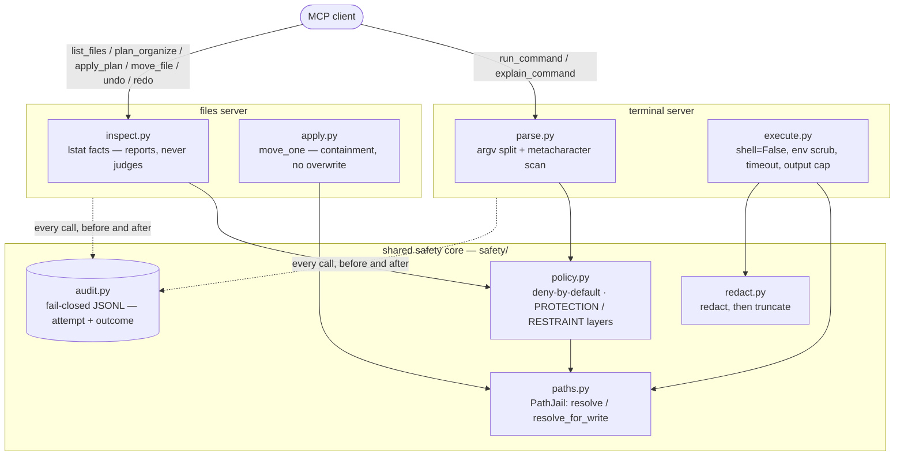

# safe-mcp-suite

A hardened suite of two [MCP](https://modelcontextprotocol.io) servers — a terminal
command executor and a file organizer — built on one shared, deny-by-default
safety core.

[](pyproject.toml)
[](LICENSE)
[](https://github.com/Asaad-Suliman/safe-mcp-suite/actions/workflows/ci.yml)
[](https://modelcontextprotocol.io)

## What this is

Giving a model raw shell access or unrestricted file-move access is dangerous:
one crafted string can chain commands or escape a directory, and a naive file
mover can overwrite or lose files with no way back. `safe-mcp-suite` turns both
into bounded, auditable operations — `safe-mcp terminal` runs a small,
explicitly allowlisted set of commands with no shell, and `safe-mcp files`
organizes a workspace with every move undoable and nothing ever silently
overwritten. Both are wiring around one shared core (`safety/`) that answers
every allow/deny question the same way: nothing is permitted unless a rule
allows it, and every decision is audited before the caller finds out what it was.

## Quickstart

Requires Python 3.12+ and [uv](https://docs.astral.sh/uv/).

Both servers take their policy file as an explicit `--config PATH` argument.
There's no default `policy.toml` lookup and nothing reads a `.env` file —
`uv run` doesn't load one on its own, so a value that lives only there is a
value the server never sees. `--config` (or the `SAFE_MCP_POLICY_FILE`
environment variable, which still works and still wins over nothing) is the
one path that's actually guaranteed.

```sh
git clone https://github.com/Asaad-Suliman/safe-mcp-suite.git safe-mcp-suite
cd safe-mcp-suite
uv sync
mkdir -p sandbox inbox state
cat > my-policy.toml <<EOF
audit_log = "$PWD/state/audit.jsonl"

[terminal]
jail_root = "$PWD/sandbox"
[terminal.allowlist]
commands = ["ls", "cat", "echo", "pwd"]

[files]
workspace_root = "$PWD/inbox"
journal = "$PWD/state/organizer-journal.json"
[files.categories]
Documents = [".pdf", ".txt", ".md"]
Images = [".jpg", ".png"]
EOF
uv run safe-mcp terminal --config my-policy.toml
uv run safe-mcp files --config my-policy.toml
```

`jail_root` and `workspace_root` are still required, here or via
`SAFE_MCP_JAIL_ROOT` / `SAFE_MCP_WORKSPACE_ROOT` — that hasn't changed.
`audit_log` and `journal` need to be outside the directory they're paired
with (a permitted command could otherwise read or forge its own audit
trail), which is why they're written as absolute paths under `state/` above
rather than left at their relative defaults.

Register with an MCP client, for example:

```json
{
  "mcpServers": {
    "safe-mcp terminal": {
      "command": "uv",
      "args": ["run", "safe-mcp", "terminal"],
      "env": {
        "SAFE_MCP_POLICY_FILE": "/srv/safe-mcp/policy.toml",
        "SAFE_MCP_JAIL_ROOT": "/srv/safe-mcp/sandbox"
      }
    },
    "safe-mcp files": {
      "command": "uv",
      "args": ["run", "safe-mcp", "files"],
      "env": {
        "SAFE_MCP_POLICY_FILE": "/srv/safe-mcp/policy.toml",
        "SAFE_MCP_WORKSPACE_ROOT": "/srv/safe-mcp/inbox"
      }
    }
  }
}
```

An MCP client sets `env` on the child process directly rather than reading
a `.env` file, so it never had the ambient-state problem the Quickstart did
— but `SAFE_MCP_POLICY_FILE` is now required there too, since startup no
longer falls back to a `policy.toml` in the working directory.

## Demo

Real output, captured from both servers running as real subprocesses, driven
over the real stdio MCP protocol, against the shipped `policy.toml` and a
throwaway workspace. Nothing below is mocked or invented.

### Terminal server

An allowed command:

```
>>> tool: run_command  args: {"command": "cat notes.txt"}
{
  "action": "run_command",
  "code": "OK",
  "detail": {
    "exit_code": 0,
    "stderr": "",
    "stdout": "demo file\n"
  },
  "duration_ms": 3,
  "ok": true,
  "reason": "'cat' is allowed"
}
```

A denied command:

```
>>> tool: run_command  args: {"command": "rm -rf /"}
{
  "action": "run_command",
  "code": "POLICY_DENIED",
  "detail": {},
  "duration_ms": 0,
  "ok": false,
  "reason": "'rm' is on the denylist"
}
```

### Files server

The workspace was seeded with `report.pdf`, `photo.png` (ordinary files),
`setup.exe` (a restraint skip — installer), `.bashrc` (a restraint skip —
dotfile), and `link.pdf`, a symlink pointing outside the workspace (a
protection skip).

`plan_organize` proposing moves and listing skips:

```
>>> tool: plan_organize  args: {}
{
  "action": "plan_organize",
  "code": "OK",
  "detail": {
    "created": "2026-08-06T12:57:58.831394+00:00",
    "move_count": 2,
    "moves": [
      { "category": "Images", "dest": "Images/photo.png", "size": 41, "src": "photo.png" },
      { "category": "Documents", "dest": "Documents/report.pdf", "size": 16, "src": "report.pdf" }
    ],
    "plan_id": "d3365a22-42b0-47f8-bc13-c0404e1f8ba2",
    "skip_count": 3,
    "skips": [
      { "code": "NEEDS_EXPLICIT_REQUEST", "name": ".bashrc", "reason": "dotfiles are configuration, not clutter to be filed", "rule": "organize" },
      { "code": "POLICY_DENIED", "name": "link.pdf", "reason": "'organize' is not permitted by any rule (deny by default)", "rule": null },
      { "code": "NEEDS_EXPLICIT_REQUEST", "name": "setup.exe", "reason": "installers, executables and application folders are left where the user put them", "rule": "organize" }
    ],
    "truncated": false
  },
  "duration_ms": 0,
  "ok": true,
  "reason": "proposed 2 move(s), skipped 3"
}
```

`apply_plan` executing that same plan:

```
>>> tool: apply_plan  args: {"plan_id": "d3365a22-42b0-47f8-bc13-c0404e1f8ba2"}
{
  "action": "apply_plan",
  "code": "OK",
  "detail": {
    "moved": 2,
    "moves": [
      { "dest": "Images/photo.png", "src": "photo.png" },
      { "dest": "Documents/report.pdf", "src": "report.pdf" }
    ],
    "plan_id": "d3365a22-42b0-47f8-bc13-c0404e1f8ba2",
    "planned": 2
  },
  "duration_ms": 2,
  "ok": true,
  "reason": "moved 2 file(s)"
}
```

`move_file` refused by PROTECTION — the same symlink `plan_organize` skipped
above, named explicitly:

```
>>> tool: move_file  args: {"src": "link.pdf", "dest": "Documents/link.pdf"}
{
  "action": "move_file",
  "code": "POLICY_DENIED",
  "detail": {},
  "duration_ms": 0,
  "ok": false,
  "reason": "'organize' is not permitted by any rule (deny by default)"
}
```

`move_file` succeeding on the installer `plan_organize` deferred with
`NEEDS_EXPLICIT_REQUEST`, now named explicitly:

```
>>> tool: move_file  args: {"src": "setup.exe", "dest": "Documents/setup.exe"}
{
  "action": "move_file",
  "code": "OK",
  "detail": {
    "dest": "Documents/setup.exe",
    "moved": 1,
    "src": "setup.exe"
  },
  "duration_ms": 0,
  "ok": true,
  "reason": "moved setup.exe"
}
```

That contrast is the point of the two-layer model below: the symlink is refused
no matter how it's asked for; the installer moves the moment it's asked for by
name.

## Architecture

Both servers are wiring. Neither re-implements policy, path containment,
redaction, or auditing — they call one shared core.



`safety/` imports nothing outside the standard library. Only the two servers
depend on the `mcp` package.

## The two-layer model: PROTECTION vs RESTRAINT

Every file rule in `policy.toml` declares a `layer`:

- **protection** — a safety invariant. Binding on every tool, however the
  request was phrased. Nothing you can ask for makes it permitted.
- **restraint** — a rule that exists because filing this _automatically_ would
  be a guess. It stops `plan_organize` acting on its own initiative; it does
  not stop a request that names one specific file.

`plan_organize` walks the workspace unprompted, so it obeys both layers.
`move_file` carries a request naming one specific file, so it obeys PROTECTION
only — a restraint rule is not a safety refusal for a caller that isn't
guessing.

The demo above is this distinction end to end, on the same two files:

- **`link.pdf`** is a symlink pointing outside the workspace. `plan_organize`
  skips it, and `move_file` refuses it too, by name, with the identical
  `POLICY_DENIED` code. There is no phrasing that gets it through.
- **`setup.exe`** is an installer. `plan_organize` skips it with
  `NEEDS_EXPLICIT_REQUEST` — not a refusal, a pointer to `move_file`. Naming it
  there succeeds.

One nuance worth being explicit about: the symlink's refusal reason reads
`"'organize' is not permitted by any rule (deny by default)"` rather than
anything mentioning "symlink". A symlink matches no _allow_ rule in either
layer, so it falls through to deny-by-default — and `safety.policy.evaluate_layered`
classifies an unmatched deny-by-default fallthrough as PROTECTION on purpose,
as the strictest reading of something the policy has no vocabulary for. The
generic wording is not a weaker guarantee; `move_file` naming the symlink
directly, above, is the proof.

## Guarantees

| Guarantee                                                                   | Enforced by                                                                                                               |
| --------------------------------------------------------------------------- | ------------------------------------------------------------------------------------------------------------------------- |
| Deny by default, in both servers                                            | `safety/policy.py` `evaluate()` — no matching rule is a denial                                                            |
| A matching deny always beats a matching allow                               | `safety/policy.py` `evaluate()` scans every match; deny short-circuits                                                    |
| No shell in the terminal server                                             | `servers/terminal/execute.py` — `subprocess.run(argv, shell=False)`                                                       |
| Shell metacharacters rejected before any policy check                       | `servers/terminal/parse.py` + `safety/patterns.py` (`; \| & < > `` $(`)                                                   |
| Commands are jailed to one directory                                        | `safety/paths.py` `PathJail.resolve`, checked on `cwd`                                                                    |
| File moves are jailed to one workspace, symlink-safe at the final component | `safety/paths.py` `PathJail.resolve_for_write` — resolves the parent only, never follows a link at the name being written |
| Two-layer file policy: safety invariant vs guess-avoidance                  | `safety/policy.py` `PROTECTION` / `RESTRAINT`, `evaluate_layered()`                                                       |
| No destination is ever silently overwritten                                 | `servers/files/apply.py` `move_one()` — `lstat`-checked before every rename                                               |
| No delete tool exists, guarded or otherwise                                 | `servers/files/server.py` — six tools, none of them delete; no argument produces one                                      |
| Every move is undoable, including a whole applied plan                      | `servers/files/journal.py` + `undo_last_action` / `redo_last_action`                                                      |
| A plan that's gone stale moves nothing at all                               | `servers/files/plan.py` `verify()` — the whole plan is refused, not a partial subset                                      |
| A hung command is killed on a deadline                                      | `servers/terminal/execute.py` — `subprocess.run(timeout=...)`                                                             |
| Output is capped, after redaction, never before                             | `safety/redact.py` `redact_and_truncate()`                                                                                |
| The child process gets a scrubbed environment                               | `servers/terminal/execute.py` — `ENV_ALLOWLIST = (PATH, HOME, LANG)`                                                      |
| Secrets are redacted from output and from audit fields alike                | `safety/redact.py` `BUILTIN_PATTERNS`, applied via one shared redactor                                                    |
| The audit trail is fail-closed by default                                   | `safety/audit.py` `AuditLogger.record()` — an unwritable log raises, and the operation never happens                      |
| Every refusal is recorded, with a reason                                    | `servers/*/server.py` `_serve()` — the single outcome-write point per tool                                                |

## Threat model — explicitly out of scope

- **A dangerous command you allowlisted.** If you allow an interpreter or a
  shell-like tool (`bash`, `python`, `sh`, `find -exec`, `awk`, `env`, …), the
  model can do anything that tool can. Policy strength is entirely the
  operator's allowlist.
- **Kernel / sandbox escapes.** The jail is a path-containment check, not a
  kernel sandbox — no namespaces, cgroups, or seccomp. See "Honest caveats".
- **Host access to the state files.** The audit log and undo journal are
  tamper-evident to the server, not tamper-proof against anyone with host
  filesystem access to them.
- **Redaction completeness.** Pattern-based and best-effort; a secret shape the
  patterns don't recognise passes through.
- **Multi-tenant identity or rate limiting.** There is no per-caller
  authentication inside either server — the trust boundary is "whoever can
  start this process," which an MCP client enforces by launching it, not this
  code.
- **A race between validating a path and acting on it (TOCTOU).** See "Honest
  caveats" below.

## Compared to a naive MCP server

Many quick MCP servers wrap `subprocess.run(cmd, shell=True)` for terminal
access and `os.rename` for file moves. Both are convenient and unsafe. This
table is factual, not a claim of perfect security.

| Concern                                   | Naive MCP server                                                 | safe-mcp-suite                                                                                                                  |
| ----------------------------------------- | ---------------------------------------------------------------- | ------------------------------------------------------------------------------------------------------------------------------- |
| Command execution                         | `subprocess.run(cmd, shell=True)` — anything the shell can parse | `argv` only, `shell=False`, deny-by-default allowlist, denylist wins                                                            |
| Shell metacharacters                      | Interpreted (`;`, `\|`, `$()`, redirection)                      | Rejected before any policy check                                                                                                |
| File moves                                | `os.rename` anywhere the process can reach                       | Jailed to one workspace; a symlink at either end is refused, never followed                                                     |
| Overwriting a file                        | Usually silent — POSIX `rename` replaces the destination         | Always refused; no numbered variant (`report(1).pdf`) is ever invented                                                          |
| Undo                                      | None                                                             | Every move is journaled; `undo_last_action` / `redo_last_action`                                                                |
| Deleting files                            | Often present, often unguarded                                   | No delete tool exists in this server, full stop                                                                                 |
| Environment given to a child process      | Full parent environment, secrets included                        | Scrubbed to `PATH` / `HOME` / `LANG`                                                                                            |
| Secrets in output or logs                 | Passed through                                                   | Redacted, before truncation, in both the response and the audit trail                                                           |
| Auditability                              | None by default                                                  | Append-only JSONL, fail-closed by default                                                                                       |
| Automatic vs. explicitly-requested action | One code path treats both the same                               | `plan_organize` (unprompted) is bound by both rule layers; `move_file` (a named request) is bound by the safety invariants only |

<details>
<summary><strong>Terminal server tool reference</strong></summary>

Both tools return an `OperationResult`:

```
OperationResult {
  ok: bool
  code: ResultCode
  action: str
  reason: str
  detail: dict            # stdout, stderr, exit_code — empty when nothing ran
  duration_ms: int
}
```

- **`run_command(command: str, cwd: str | None = None)`** — evaluate `command`
  against policy and, if allowed, run it sandboxed. `cwd` is optional and must
  resolve inside the jail root; a traversal, symlink, or absolute path that
  escapes returns `PATH_ESCAPE` without running anything. Every invocation is
  audited; under fail-closed auditing an unwritable log returns
  `AUDIT_UNAVAILABLE` rather than executing unlogged. A non-zero exit code is
  still `ok: true` — the command ran; whether it succeeded is its own business.
- **`explain_command(command: str)`** — the dry run. Reaches the same parse
  and evaluation as `run_command` and returns before the executor, so
  `detail` never carries `stdout`, `stderr`, or an exit code — nothing ran.

Result codes this server can return: `OK`, `POLICY_DENIED`, `INVALID_REQUEST`,
`PATH_ESCAPE`, `TIMEOUT`, `OUTPUT_TRUNCATED`, `OPERATION_FAILED`,
`AUDIT_UNAVAILABLE`, `INTERNAL_ERROR`.

</details>

<details>
<summary><strong>Files server tool reference</strong></summary>

Six tools, and the list is the design — there is no seventh, and none of them
delete.

- **`list_files(subdir: str | None = None)`** — read-only. Reports each
  entry's name, size, category, whether the organizer would move it, and why
  not when it wouldn't.
- **`plan_organize()`** — proposes moves and skips. Changes nothing, not even
  destination folders. Returns a `plan_id` to pass to `apply_plan`.
- **`apply_plan(plan_id: str)`** — carries out a plan. Every file is
  re-checked first; if any changed, moved, or vanished since planning, the
  _whole_ plan is refused. Single-use — an id cannot be replayed.
- **`move_file(src: str, dest: str)`** — moves one named file. `dest` is the
  full destination path, not a folder. A destination that already exists is
  refused, never overwritten and never renamed around. Obeys PROTECTION rules
  only — see "The two-layer model" above.
- **`undo_last_action()`** — reverses the most recent move or applied plan, as
  one action. Nothing is overwritten to make room for a restored file.
- **`redo_last_action()`** — reapplies the most recently undone action. The
  redo stack clears whenever new work is recorded.

Result codes this server can additionally return: `NEEDS_EXPLICIT_REQUEST`
(cleared every safety invariant, declined only because acting unprompted would
be a guess — name the target directly and ask).

</details>

<details>
<summary><strong>Configuration reference</strong></summary>

One file, `policy.toml`, read by both servers:

```toml
audit_log = "audit.jsonl"          # shared
audit_fail_mode = "closed"         # shared: "closed" or "open"

[redaction]                        # shared
enabled = true
entropy_fallback = false
extra_patterns = []                # [{ name = "...", regex = "..." }]

[terminal]
# jail_root = "/srv/safe-mcp/sandbox"   # REQUIRED — here or via env

[terminal.limits]
timeout_seconds = 30
max_output_bytes = 65536

[terminal.allowlist]
commands = ["ls", "cat", "echo", "pwd", "git"]

[terminal.denylist]
commands = ["rm", "shutdown", "reboot", "curl", "wget", "chmod", "sudo"]

[[terminal.rules]]
command = "git"
deny_args = ["push --force", "push -f"]
reason = "force-push rewrites shared history"

[files]
# workspace_root = "/srv/safe-mcp/inbox"   # REQUIRED — here or via env
journal = "organizer-journal.json"
max_plan_moves = 500

[files.categories]
Documents = [".pdf", ".doc", ".docx", "..."]
# ...

[[files.skip]]
layer = "protection"   # or "restraint" — required, no default
when = ["unsafe-name"]
reason = "..."
```

The policy file itself has no default location. Point at it with `--config`:

```sh
safe-mcp terminal --config /path/to/policy.toml
safe-mcp files --config /path/to/policy.toml
```

Environment variables remain supported and every one overrides the matching
`policy.toml` key. `SAFE_MCP_POLICY_FILE` is the one exception worth calling
out: it's an alternative to `--config`, not an override of it — `--config`
wins if both are given, and startup refuses if neither is.

| Variable                   | Meaning                                                                  | Default                  |
| -------------------------- | ------------------------------------------------------------------------ | ------------------------ |
| `SAFE_MCP_POLICY_FILE`     | Path to `policy.toml` (**required**, here or `--config`)                 | none — refuses to start  |
| `SAFE_MCP_JAIL_ROOT`       | Terminal jail directory (**required**, here or `jail_root`)              | none — refuses to start  |
| `SAFE_MCP_WORKSPACE_ROOT`  | Files workspace directory (**required**, here or `files.workspace_root`) | none — refuses to start  |
| `SAFE_MCP_FILES_JOURNAL`   | Undo/redo journal path (must live outside the workspace)                 | `organizer-journal.json` |
| `SAFE_MCP_AUDIT_LOG`       | Shared audit trail path (must live outside both jails)                   | `audit.jsonl`            |
| `SAFE_MCP_AUDIT_FAIL_MODE` | `closed` or `open`                                                       | `closed`                 |

Startup fails loudly — a printed `fatal:` message and a non-zero exit — on no
policy file path given at all (neither `--config` nor `SAFE_MCP_POLICY_FILE`),
a missing or invalid `policy.toml`, an unset or non-directory jail/workspace
root, an invalid operator redaction regex, an unlabeled `[[files.skip]]`
entry, or an audit log / journal located inside a jail it would then be able
to move or forge.

</details>

## Honest caveats

This is a hardening layer, not a vault. Read these before deploying either
server.

- **The jail is a path-containment check, not a kernel sandbox.** No
  namespaces, cgroups, or seccomp. A kernel exploit or an escape hatch reachable
  from an allowlisted binary is not contained.
- **The audit log is tamper-evident, not tamper-proof, and has no rotation.**
  Append-only with per-record flush + fsync means it won't lose records to a
  crash, but anyone with host filesystem access to `audit.jsonl` can read,
  alter, or delete it — and the file grows without bound; there is no rotation
  or retention policy built in.
- **Redaction is pattern-based and best-effort.** It catches common secret
  shapes; a novel or unusual format passes through unredacted. The optional
  entropy fallback is off by default because it's noisy on git SHAs, UUIDs,
  and base64 data, not because it's weak.
- **Terminal metacharacters are rejected even inside quotes — a known
  ceiling.** `echo "a;b"` is refused even though the `;` is inert inside the
  quotes, because the scan is a raw substring check with no awareness of
  quoting. That is the safe direction to be wrong in — there is no quoting
  trick that gets an operator past a scan that ignores quoting in the first
  place — but it does mean some legitimate input is refused.
- **TOCTOU: a path validated then acted upon can change in between.** Both
  `safety/paths.py` and `servers/files/apply.py` check containment or
  occupancy and then act on a separate syscall; a symlink swapped or a file
  created in that gap is not covered. Documented in-code as a deliberate,
  named ceiling (`# NOTE:` comments in both files), with an upgrade path
  (`O_NOFOLLOW` plus dir-fd relative operations) noted for if it's ever needed.
- **Grandchild processes are not reaped.** A killed or timed-out command's own
  child processes are not in a separate process group; the executor kills the
  direct child only, so anything that command spawned can outlive it.

## Related work

- [hardened-terminal-mcp](https://github.com/Asaad-Suliman/hardened-terminal-mcp) —
  the standalone predecessor to this suite's terminal server.
- [MCP-file-organizer](https://github.com/Asaad-Suliman/MCP-file-organizer) —
  the standalone predecessor to this suite's file server.

## License

MIT — see [LICENSE](LICENSE).
